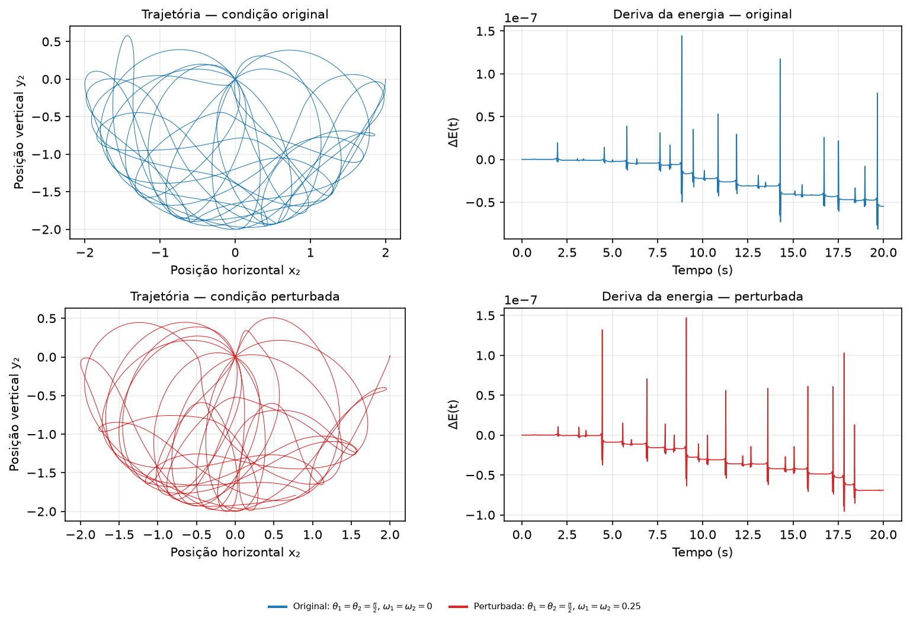
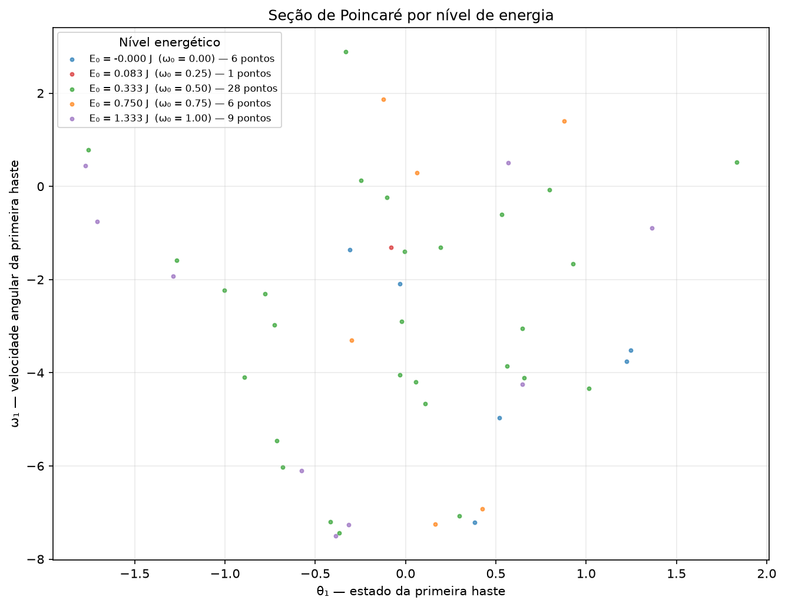

# Instruction
This repository was created to keep all studies in fields related to chaotic systems, including nonlinearity and dynamical systems.

# Study Proposal

The purpose of this repository is to study chaos and, more specifically, understand how deterministic, nonlinear, and coupled systems can exhibit extremely complex behavior that is sensitive to initial conditions. The main object of study is the double pendulum, a system that is simple in description yet sufficiently complex to reveal interactions between periodic, quasiperiodic, and chaotic motion.

Throughout the study, physical behavior is translated into differential equations and analyzed through computational simulations. In addition to the temporal evolution of the angles and angular velocities, the study considers the state space, conservation of mechanical energy, the trajectory of the system's endpoint, and the effect of small changes in initial conditions.

## Completed Studies

The reports already produced in this repository address the following aspects:

- **Double-pendulum modeling:** formulation of the state using the angles and angular velocities of the two rods, derivation of the coupled accelerations, and implementation of the differential equations in Python.
- **Numerical integration:** use of the fourth-order Runge-Kutta method to approximate the system's temporal evolution and analysis of numerical accuracy through variations in mechanical energy.
- **Origin of nonlinearity:** identification of the trigonometric terms, products involving squared angular velocities, and geometric coupling responsible for the complex dynamics.
- **Sensitivity to initial conditions:** comparison of nearby trajectories and discussion of how small perturbations can grow and produce substantially different motions over time.
- **Trajectory analysis:** conversion of angular coordinates into planar positions and visualization of the trajectory described by the endpoint of the second rod.
- **Poincaré section:** reduction of the four-dimensional continuous trajectory to a two-dimensional map formed by $(\theta_1, \omega_1)$ pairs recorded whenever $\theta_2=0$ and $\omega_2>0$.
- **Comparison by energy levels:** investigation of different initial states and analysis of patterns corresponding to different energy surfaces.

The results show that the conservative model can exhibit organized sets of points, regular curves, and dense regions consistent with quasiperiodic or chaotic motion. The main conclusion is that the irregular behavior observed in the double pendulum does not arise from external randomness: it emerges from the deterministic equations, nonlinearity, and sensitivity to initial conditions.

The report files `report.md` and `estudo.md` present the mathematical and computational development, while the notebooks `Penduloduplo.ipynb` and `SecaoPoincare.ipynb` contain the corresponding implementations and visualizations.

## Study Visualizations

### Double-Pendulum Motion Comparison

### Poincaré Section by Energy Levels

