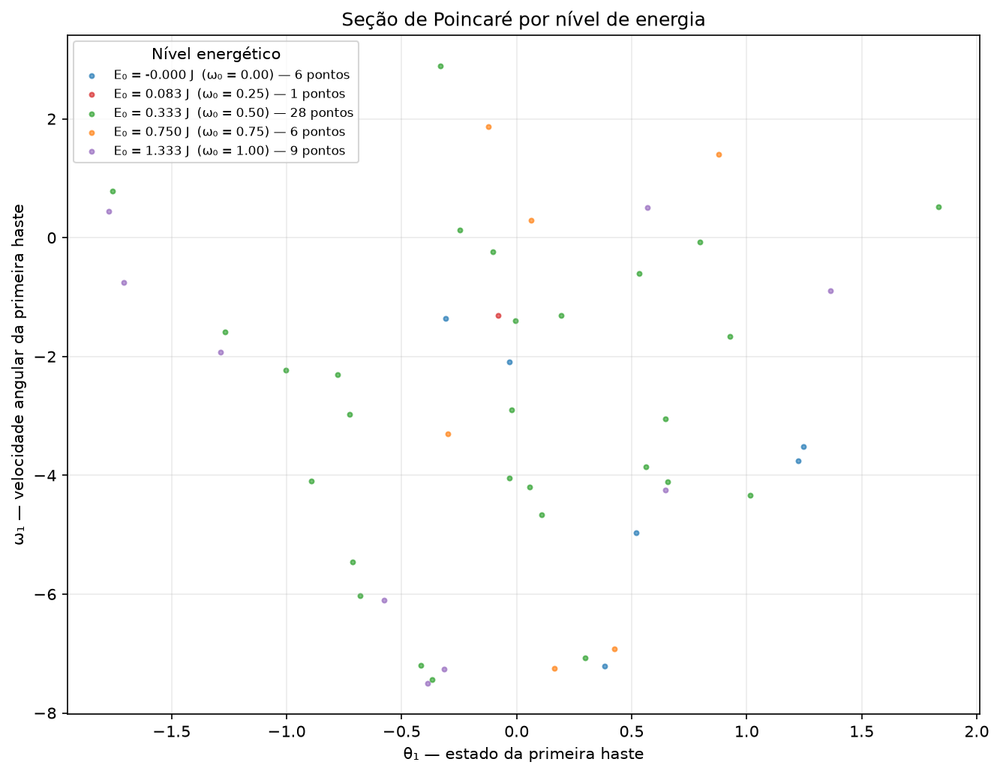

# Seção de Poincaré do Pêndulo Duplo

## 1. Objetivo

Este estudo utiliza uma seção de Poincaré para visualizar a estrutura do espaço de estados do pêndulo duplo. O método registra pontos da trajetória somente quando uma superfície escolhida é cruzada, reduzindo a dimensão do problema e permitindo distinguir comportamento periódico, quase periódico e caótico.

## 2. Superfície de Poincaré

Considerando o estado

$$
\mathbf{y}=(\theta_1,\theta_2,\omega_1,\omega_2),
$$

foi utilizada a superfície

$$
\Sigma:\theta_2=0,
\qquad
\omega_2>0.
$$

Um ponto é registrado a cada passagem da segunda haste pela posição vertical, com movimento ascendente segundo o sentido adotado. Os pontos registrados são representados no plano

$$
(\theta_1,\omega_1).
$$

Como o sistema conservativo possui a constante de energia

$$
E=T+U,
$$

todas as trajetórias comparadas neste plano devem idealmente pertencer à mesma superfície energética. Portanto, diferentes padrões na seção não devem ser atribuídos a diferenças de energia.

## 3. Implementação

Cada simulação utiliza o mesmo integrador RK4 empregado no estudo principal. O cruzamento é detectado quando

$$
\theta_2(t_n)\theta_2(t_{n+1})<0
$$

e $\omega_2$ é positivo no intervalo. Esse critério registra aproximadamente uma vez por ciclo da segunda haste.

Para a interseção mais precisa, o código interpola linearmente a posição entre os dois passos:

$$
f=\frac{-\theta_{2,n}}{\theta_{2,n+1}-\theta_{2,n}},
$$

$$
\theta_{1,P}=\theta_{1,n}+f(\theta_{1,n+1}-\theta_{1,n}),
$$

$$
\omega_{1,P}=\omega_{1,n}+f(\omega_{1,n+1}-\omega_{1,n}).
$$

## 4. Interpretação dos padrões

Uma órbita periódica pode aparecer como poucos pontos isolados, pois a seção sempre encontra a mesma combinação de $\theta_1$ e $\omega_1$. Uma órbita quase periódica normalmente gera uma curva fechada formada por muitos pontos. Essa curva indica movimento regular em um toro, projetado pela seção de Poincaré.

Uma órbita caótica não forma uma curva fechada simples. Os pontos podem preencher regiões bidimensionais ou estruturas com faixas entrelaçadas. Quando o mesmo gráfico contém pontos de várias condições iniciais, curvas invariantes coexistem com regiões caóticas.

O mapa de Poincaré não torna o sistema aleatório. Ele apenas remove uma dimensão ao longo do tempo e revela a organização da dinâmica. A presença de dispersão dos pontos indica sensibilidade às condições iniciais e crescimento de perturbações.

## 5. Conclusão

A seção de Poincaré reduz a trajetória contínua de quatro dimensões a uma coleção de pontos em um plano bidimensional. Nesse plano, órbitas regulares aparecem como pontos ou curvas organizadas, enquanto o caos aparece como regiões densas ou estruturas complexas. Esse método é especialmente útil para o pêndulo duplo porque evita que o movimento tridimensional da trajetória física esconda a existência de regiões periódicas e caóticas.

## 6. Relação matemática entre o código e o fluxo dinâmico

### 6.1 Espaço de estados

O estado físico é descrito pelo vetor

$$
\mathbf{y}(t)=
\begin{bmatrix}
\theta_1(t)&\theta_2(t)&\omega_1(t)&\omega_2(t)
\end{bmatrix}^{T},
$$

cuja evolução é determinada pelo sistema autônomo

$$
\dot{\mathbf{y}}=\mathbf{F}(\mathbf{y}).
$$

A função `derivadas` implementa diretamente essa operação, enquanto `aceleracoes` calcula $\alpha_1$ e $\alpha_2$. Portanto, a correspondência no código é:

- `y[0]` corresponde a $\theta_1$;
- `y[1]` corresponde a $\theta_2$;
- `y[2]` corresponde a $\omega_1$;
- `y[3]` corresponde a $\omega_2$;
- `a1` e `a2` correspondem às acelerações angulares;
- o vetor retornado por `derivadas` corresponde a $(\omega_1,\omega_2,\alpha_1,\alpha_2)$.

Essa correspondência é a tradução computacional do campo vetorial matemático. Cada chamada de `derivadas` fornece a direção instantânea do fluxo no espaço de estados.

### 6.2 Método RK4

Para um passo temporal $h$, o integrador implementado aproxima

$$
\mathbf{y}_{n+1}
=
\mathbf{y}_n+
\frac{h}{6}(\mathbf{k}_1+2\mathbf{k}_2+2\mathbf{k}_3+\mathbf{k}_4).
$$

Os vetores intermediários são

$$
\begin{aligned}
\mathbf{k}_1&=\mathbf F(t_n,\mathbf y_n),\\
\mathbf{k}_2&=\mathbf F(t_n+h/2,\mathbf y_n+h\mathbf k_1/2),\\
\mathbf{k}_3&=\mathbf F(t_n+h/2,\mathbf y_n+h\mathbf k_2/2),\\
\mathbf{k}_4&=\mathbf F(t_n+h,\mathbf y_n+h\mathbf k_3).
\end{aligned}
$$

O RK4 é empregado porque o sistema possui termos não lineares acoplados. Métodos de primeira ordem podem acumular erro mais rapidamente, sobretudo quando velocidades ou deslocamentos são grandes.

### 6.3 Não linearidade nas acelerações

A variável `delta` representa

$$
\Delta=\theta_1-\theta_2.
$$

Essa diferença modifica tanto a geometria do acoplamento quanto a distribuição das forças. O denominador

$$
D=16-9\cos^2(\Delta)
$$

provém da estrutura matricial da dinâmica e depende da configuração angular das hastes.

Os termos de gravidade introduzem $\sin\theta_1$ e $\sin\theta_2$, e os termos de interação contém $\cos\Delta$, $\sin\Delta$ e velocidades ao quadrado. A não linearidade impede a separação da dinâmica em modos independentes. Além disso, o jacobiano

$$
J(\mathbf y)=\frac{\partial\mathbf F}{\partial\mathbf y}
$$

varia ao longo da trajetória. Dois estados próximos podem, portanto, apresentar taxas de separação diferentes ao longo do tempo.

## 7. Construção matemática da seção

Seja $\phi_t$ o fluxo gerado pelas equações. Uma seção de Poincaré é uma aplicação

$$
P:\Sigma\rightarrow\Sigma,
$$

definida pelo primeiro retorno da trajetória à superfície $\Sigma$. Neste estudo,

$$
\Sigma=\{\mathbf y:\theta_2=0,\ \omega_2>0\}.
$$

A aplicação registra

$$
P(\theta_1,\omega_1)_P=(\theta_{1,P},\omega_{1,P}).
$$

Assim, a sequência obtida é

$$
\mathbf z_{n+1}=P(\mathbf z_n),
$$

em que

$$
\mathbf z_n=(\theta_1,\omega_1).
$$

O sinal contrário de `th2_atual` e `th2_seguinte` representa a mudança de lado da haste em relação à superfície $\theta_2=0$. O teste $\omega_2>0$ define apenas uma direção de cruzamento e não registra a passagem contrária.

## 8. Interpretação física da superfície

Quando $\theta_2=0$, a segunda haste está alinhada verticalmente para baixo ou para cima, dependendo da convenção dos ângulos. Exigir $\omega_2>0$ seleciona um sentido definido de passagem. O par $(\theta_1,\omega_1)$ descreve o estado completo da primeira haste naquele instante.

Na trajetória contínua, o movimento da ponta da segunda haste pode formar uma curva complexa no plano físico. A seção de Poincaré substitui essa curva por pontos selecionados em eventos físicos bem definidos. Dessa forma, padrões periódicos ou caóticos tornam-se mais facilmente observáveis.

No sistema ideal, a energia é conservada:

$$
E=T+U,
$$

com

$$
T=\frac{ml^2}{6}\left(4\omega_1^2+\omega_2^2
+3\omega_1\omega_2\cos(\theta_1-\theta_2)\right)
$$

e

$$
U=-\frac12mgl\left(3\cos\theta_1+\cos\theta_2\right).
$$

Uma trajetória conservativa permanece em uma superfície de energia constante. Consequentemente, a estrutura da seção depende da geometria do fluxo naquela superfície, não de uma dissipação artificial.

## 9. Caracterização dos resultados

Em uma seção de Poincaré:

- um único ponto ou poucos pontos indicam uma órbita periódica;
- uma curva fechada indica movimento quase periódico ou ressonante;
- regiões densas ou estruturas fragmentadas indicam comportamento caótico;
- curvas invariantes misturadas a regiões caóticas indicam coexistência de regularidade e instabilidade no mesmo sistema.

Para condições iniciais próximas,

$$
\mathbf y_2(0)=\mathbf y_1(0)+\delta\mathbf y(0),
$$

as trajetórias podem estar próximas durante parte da evolução e separar-se posteriormente. Em regiões instáveis, essa separação pode crescer aproximadamente como

$$
\|\delta\mathbf y(t)\|
\approx
\|\delta\mathbf y(0)\|e^{\lambda t},
$$

com $\lambda$ positivo. Esse crescimento caracteriza a sensibilidade às condições iniciais. Não implica aleatoriedade, pois toda a dinâmica continua determinada pelas equações.

## 10. Discussão das condições utilizadas

### 10.1 Condição original

$$
\mathbf y_0=(\pi/2,\pi/2,0,0).
$$

As duas hastes começam horizontais e em repouso. A gravidade fornece a dinâmica, mas não há velocidade inicial que redistribua imediatamente a energia cinética.

### 10.2 Velocidades iniciais iguais a 0,25

$$
\mathbf y_1=(\pi/2,\pi/2,0{,}25,0{,}25).
$$

A condição adiciona energia cinética e altera a relação entre a energia cinética e a potencial. As hastes podem apresentar acoplamento mais intenso e cruzamentos com padrões menos previsíveis.

### 10.3 Perturbação próxima

$$
\mathbf y_2=(\pi/2,\pi/2+0{,}01,0{,}25,0{,}25).
$$

Essa condição difere de `Velocidades 0.25` apenas pela posição inicial da segunda haste. Ela permite observar sensibilidade mesmo em uma perturbação pequena. Na seção de Poincaré, essa condição pode começar próxima de outra trajetória e separar-se dela após muitos cruzamentos.

## 11. Seção de Poincaré por níveis de energia

### 11.1 Motivação

Uma análise por níveis de energia é adequada porque, no pêndulo duplo conservativo, cada órbita permanece em uma superfície definida pela energia mecânica

$$
E=\frac{ml^2}{6}\left(4\omega_1^2+\omega_2^2+3\omega_1\omega_2\cos(\theta_1-\theta_2)\right)
-
\frac{1}{2}mgl\left(3\cos\theta_1+\cos\theta_2\right).
$$

Diferentes energias produzem regiões geometricamente distintas no espaço de estados. Portanto, para comparar órbitas, é necessário separar os resultados pelos valores de $E_0$.

Neste estudo foram mantidos

$$
\theta_1(0)=\theta_2(0)=\frac{\pi}{2},
\qquad
\omega_1(0)=\omega_2(0)=w_0,
$$

com $w_0\in\{0, 0{,}25, 0{,}50, 0{,}75, 1{,}00\}$ rad/s.

Como nessa posição horizontal a energia potencial é a mesma para todas as condições, as variações da energia inicial são proporcionais à velocidade inicial.

### 11.2 Cálculo da energia inicial

Para $m=l=1$, a condição inicial fornece

$$
T_0=
\frac{1}{6}\left(4w_0^2+w_0^2+3w_0^2\cos0\right)
=\frac{8w_0^2}{6}
=\frac{4}{3}w_0^2.
$$

Assim, os níveis utilizados são:

| $w_0$ | $E_0$ | Estado inicial |
|---:|---:|---|
| 0,00 | 0,000 J | $(\pi/2,\pi/2,0,0)$ |
| 0,25 | 0,083 J | $(\pi/2,\pi/2,0{,}25,0{,}25)$ |
| 0,50 | 0,333 J | $(\pi/2,\pi/2,0{,}50,0{,}50)$ |
| 0,75 | 0,750 J | $(\pi/2,\pi/2,0{,}75,0{,}75)$ |
| 1,00 | 1,333 J | $(\pi/2,\pi/2,1{,}00,1{,}00)$ |

No código, o vetor inicial e a energia são associados por:

```python
y0 = np.array([np.pi/2, np.pi/2, w, w])
energia_inicial = energia(y0)
nome = f"E₀ = {energia_inicial:.3f} J  (ω₀ = {w:.2f})"
condicoes_energia[nome] = y0
```

Essa estrutura permite enviar cada estado ao integrador e identificar automaticamente o nível energético correspondente no gráfico.

## 12. Implementação da integração

O vetor de estado é

$$
\mathbf y=(\theta_1,\theta_2,\omega_1,\omega_2).
$$

A função `derivadas` implementa

$$
\dot{\mathbf y}
=
(\omega_1,\omega_2,\alpha_1,\alpha_2).
$$

A função `rk4` aproxima essa evolução pelo método clássico de quarta ordem:

$$
\mathbf y_{n+1}
=
\mathbf y_n+
\frac h6\left(\mathbf k_1+2\mathbf k_2+2\mathbf k_3+\mathbf k_4\right).
$$

No notebook, $h$ é determinado pela diferença uniforme entre os instantes:

```python
tempos = np.arange(0, 300, 0.005)
dt = tempos[1]-tempos[0]
```

O passo de $0{,}005$ s permite observar muitos cruzamentos, mantendo viável a execução computacional.

## 13. Construção da seção de Poincaré

A seção escolhida é

$$
\Sigma=\{\mathbf y\mid\theta_2=0,\ \omega_2>0\}.
$$

O plano de representação é $(\theta_1,\omega_1)$. Essa escolha preserva dois graus de liberdade relevantes da dinâmica: a posição e a velocidade da primeira haste no evento em que a segunda haste cruza verticalmente a posição $\theta_2=0$ em uma direção fixada.

Para cada dois estados consecutivos, o código verifica

$$
\theta_{2,n}\theta_{2,n+1}<0
$$

e

$$
\omega_{2,n+1}>0.
$$

O primeiro teste identifica que a segunda haste atravessou o plano. O segundo fixa a direção do cruzamento.

### 13.1 Interpolação do cruzamento

O instante exato não coincide necessariamente com os instantes discretos da integração. Por isso, define-se

$$
f=-\frac{\theta_{2,n}}{\theta_{2,n+1}-\theta_{2,n}},
$$

com $0<f<1$, e estima-se

$$
\theta_{1,P}=\theta_{1,n}+f(\theta_{1,n+1}-\theta_{1,n}),
$$

$$
\omega_{1,P}=\omega_{1,n}+f(\omega_{1,n+1}-\omega_{1,n}).
$$

Essas operações aproximam o estado sobre $\theta_2=0$ por interpolação linear entre os dois passos consecutivos.

### 13.2 Implementação

A função completa utilizada no notebook é:

```python
def secao_por_nivel_de_energia(tempos, y0, g=9.8, l=1.0):
    fun = lambda t, y: derivadas(y, g=g, l=l)
    estados = rk4(fun, tempos, y0)
    pontos = []

    for i in range(len(estados)-1):
        th2_atual = estados[i, 1]
        th2_seguinte = estados[i+1, 1]

        if th2_atual * th2_seguinte < 0 and estados[i+1, 3] > 0:
            alpha = -th2_atual/(th2_seguinte-th2_atual)
            th1_p = estados[i, 0] + alpha*(estados[i+1, 0]-estados[i, 0])
            w1_p = estados[i, 2] + alpha*(estados[i+1, 2]-estados[i, 2])
            pontos.append([th1_p, w1_p])

    return np.array(pontos)
```

Cada linha possui uma correspondência direta:

- `estados` contém a solução contínua discretizada;
- `th2_atual` e `th2_seguinte` localizam o cruzamento;
- `estados[i+1,3] > 0` exige a direção positiva de $\omega_2$;
- `alpha` fornece a fração entre os dois estados;
- `th1_p` e `w1_p` são as coordenadas do mapa;
- `pontos` contém a sequência $\mathbf z_n=(\theta_{1,P},\omega_{1,P})$.

## 14. O mapa de Poincaré

Matematicamente, seja $\phi_t$ o fluxo gerado pela equação diferencial. A seção define uma aplicação

$$
P:\Sigma\rightarrow\Sigma,
$$

que leva um ponto da superfície ao próximo ponto em que a trajetória o atravessa novamente:

$$
\mathbf z_{n+1}=P(\mathbf z_n).
$$

Portanto, o gráfico não representa trajetórias contínuas no tempo. Ele representa a iteração discreta do mapa $P$. Isso permite distinguir movimentos por sua recorrência:

- ponto fixo: órbita periódica que sempre retorna ao mesmo estado;
- conjunto finito de pontos: órbita periódica com múltiplos ciclos;
- curva fechada: movimento quase periódico ou regular;
- conjunto bidimensional denso: comportamento caótico;
- faixas e estruturas fractais: regiões de trânsito irregular ou mistura.

## 15. Resultados por nível de energia



Cada cor representa uma condição inicial com uma energia mecânica inicial específica. Os diferentes conjuntos não devem ser interpretados como cinco trajetórias independentes de uma mesma superfície; cada nível corresponde a uma superfície energética própria.

Níveis baixos tendem a gerar regiões mais organizadas, pois os deslocamentos são menores e a aproximação linear pode ser mais representativa. À medida que a velocidade inicial aumenta:

- os termos $\sin\theta_i$ tornam-se mais não lineares;
- o acoplamento geométrico se intensifica;
- a trajetória pode atingir amplitudes maiores;
- os cruzamentos podem ocupar regiões mais amplas;
- a separação entre estados próximos torna-se mais sensível.

Essas mudanças não constituem uma demonstração isolada de caos, pois a identificação rigorosa requer análise adicional, como expoentes de Lyapunov ou comparação sistemática de perturbações. Contudo, padrões fragmentados ou densos podem ser evidências numéricas consistentes com a dinâmica não linear observada.

### 15.1 Observações da figura atualizada

A figura atualizada registra a seção de Poincaré no plano $(\theta_1,\omega_1)$ e apresenta a quantidade de cruzamentos encontrada em cada nível energético:

- $E_0=0{,}000$ J, com $\omega_0=0{,}00$: 6 pontos;
- $E_0=0{,}083$ J, com $\omega_0=0{,}25$: 1 ponto;
- $E_0=0{,}333$ J, com $\omega_0=0{,}50$: 28 pontos;
- $E_0=0{,}750$ J, com $\omega_0=0{,}75$: 6 pontos;
- $E_0=1{,}333$ J, com $\omega_0=1{,}00$: 9 pontos.

O nível $0{,}083$ J apresenta apenas um ponto porque a condição produz poucos cruzamentos da superfície $\theta_2=0$ com $\omega_2>0$ no intervalo observado. Esse resultado não representa necessariamente uma órbita caótica ou regular por si só, pois o número de retornos pode depender da condição inicial, da duração da simulação e da direção da seção.

Os níveis $0{,}333$ J e $1{,}333$ J apresentam maior quantidade de pontos, com maior ocupação da região mostrada no plano. Isso indica uma dinâmica com cruzamentos frequentes da superfície escolhida.

É importante não interpretar apenas a densidade visual como prova de caos. Uma órbita periódica pode produzir poucos pontos repetidos, enquanto uma órbita quase periódica pode formar uma curva organizada. Uma conclusão sobre caos exige comparação sistemática das trajetórias e idealmente análise da sensibilidade às condições iniciais ou dos expoentes de Lyapunov.

### 15.2 Código da legenda e interpretação

A legenda inclui o nível energético e o número de cruzamentos:

```python
label=f"{nome} — {len(pontos)} pontos"
```

Essa informação permite relacionar cada conjunto de pontos a uma condição inicial sem confundir os níveis. O eixo horizontal representa $\theta_1$, enquanto o eixo vertical representa $\omega_1$ no instante em que $\theta_2=0$ e $\omega_2>0$.

Os diferentes níveis não devem ser interpretados como se estivessem sobre uma mesma superfície energética. Cada cor corresponde a uma trajetória com energia inicial própria.

## 16. Interpretação física

Na superfície $\theta_2=0$, a segunda haste passa pela posição vertical enquanto continua girando. Nesse evento, registra-se o estado da primeira haste. O mapa compara o estado angular da primeira haste em visitas consecutivas a um mesmo evento físico da segunda haste.

Isso cria uma conexão direta entre geometria, cinemática e dinâmica:

- $\theta_1$ informa a orientação da primeira haste;
- $\omega_1$ informa sua velocidade angular;
- $\theta_2=0$ é o evento de redução temporal;
- $\omega_2>0$ seleciona a direção de cruzamento;
- $E_0$ separa as superfícies analisadas.

A figura não descreve diretamente uma trajetória espacial no plano físico; ela representa recorrências no espaço de estados reduzido.

## 17. Conclusão

O algoritmo integra o pêndulo duplo por RK4, calcula os estados sucessivos e detecta cruzamentos com a superfície $\theta_2=0$, $\omega_2>0$. Cada cruzamento é interpolado e projetado em $(\theta_1,\omega_1)$.

Ao separar as condições por $E_0$, o gráfico permite relacionar o comportamento observado com a energia mecânica inicial. Pontos isolados sugerem periodicidade, curvas organizadas sugerem regularidade quase periódica e regiões densas são compatíveis com dinâmica caótica.

### 12.1 Explicação operacional do código

O notebook pode ser compreendido em seis etapas sequenciais:

#### Etapa 1 — Importação das bibliotecas

```python
import numpy as np
import matplotlib.pyplot as plt
```

O `NumPy` é utilizado para vetores, matrizes, funções trigonométricas e operações numéricas. O `Matplotlib` é responsável pela construção da seção de Poincaré.

#### Etapa 2 — Definição do estado

Cada configuração do sistema é representada por

```python
y = np.array([theta1, theta2, w1, w2])
```

ou seja,

$$
\texttt{y}=\begin{bmatrix}\theta_1&\theta_2&\omega_1&\omega_2\end{bmatrix}^{T}.
$$

Essa organização permite que todas as equações recebam e devolvam o mesmo conjunto de variáveis.

#### Etapa 3 — Cálculo das acelerações

A função `aceleracoes` descompacta o vetor:

```python
theta1, theta2, w1, w2 = y
```

Em seguida, calcula a diferença angular

```python
delta = theta1 - theta2
```

e o denominador

```python
den = 16 - 9*np.cos(delta)**2
```

As acelerações são implementadas pelas expressões $\alpha_1$ e $\alpha_2$ já apresentadas neste relatório. O resultado é devolvido como

```python
return a1, a2
```

Assim, `a1` contém $\alpha_1=\ddot{\theta}_1$ e `a2` contém $\alpha_2=\ddot{\theta}_2$.

#### Etapa 4 — Construção do campo vetorial

A função `derivadas` cria o vetor

$$
\left(\omega_1,\omega_2,\alpha_1,\alpha_2\right),
$$

por meio de:

```python
a1, a2 = aceleracoes(y, g=g, l=l)
return np.array([y[2], y[3], a1, a2])
```

Essa é a implementação direta de

$$
\dot{\theta}_1=\omega_1,
\qquad
\dot{\theta}_2=\omega_2,
\qquad
\dot{\omega}_1=\alpha_1,
\qquad
\dot{\omega}_2=\alpha_2.
$$

O integrador fornecido à RK4 espera exatamente uma função que recebe o instante e o estado e devolve essa derivada.

#### Etapa 5 — Integração com RK4

A função `rk4` inicia uma lista contendo a condição inicial:

```python
y = [np.array(y0, dtype=float)]
```

Em cada passo, calcula-se

```python
k1 = fun(t, y[-1])
k2 = fun(t + dt/2, y[-1] + dt*k1/2)
k3 = fun(t + dt/2, y[-1] + dt*k2/2)
k4 = fun(t + dt, y[-1] + dt*k3)
```

e atualiza-se o estado:

```python
y.append(y[-1] + dt/6*(k1 + 2*k2 + 2*k3 + k4))
```

O processo é repetido para todos os intervalos. O retorno da função é convertido em matriz NumPy para permitir o acesso às colunas dos ângulos e das velocidades.

#### Etapa 6 — Definição dos níveis energéticos

No nível correspondente a cada valor de $w_0$:

```python
y0 = np.array([np.pi/2, np.pi/2, w, w])
energia_inicial = energia(y0)
nome = f"E₀ = {energia_inicial:.3f} J  (ω₀ = {w:.2f})"
condicoes_energia[nome] = y0
```

As posições iniciais permanecem fixas; somente a velocidade inicial muda. Isso permite comparar superfícies com diferentes níveis de energia inicial. A expressão `w` percorrida pelo vetor `velocidades` é usada simultaneamente para $\omega_1(0)$ e $\omega_2(0)$.

#### Etapa 7 — Geração da solução

Dentro de `secao_por_nivel_de_energia`, executa-se:

```python
fun = lambda t, y: derivadas(y, g=g, l=l)
estados = rk4(fun, tempos, y0)
```

A variável `estados` possui uma linha por instante e uma coluna por componente do vetor de estado:

- coluna 0: $\theta_1$;
- coluna 1: $\theta_2$;
- coluna 2: $\omega_1$;
- coluna 3: $\omega_2$.

#### Etapa 8 — Detecção do cruzamento

Para cada par de estados consecutivos:

```python
th2_atual = estados[i, 1]
th2_seguinte = estados[i+1, 1]
```

O teste

```python
th2_atual * th2_seguinte < 0
```

é verdadeiro quando $\theta_2$ mudou de sinal entre os instantes. Como a trajetória não muda de sinal sem cruzar $\theta_2=0$, esse teste localiza uma passagem pela superfície.

A condição

```python
estados[i+1, 3] > 0
```

garante que a velocidade da segunda haste seja positiva no cruzamento, preservando a direção $\omega_2>0$.

#### Etapa 9 — Interpolação

Como o cruzamento pode ocorrer entre $t_n$ e $t_{n+1}$, calcula-se:

```python
alpha = -th2_atual/(th2_seguinte-th2_atual)
```

Esse valor representa a fração do intervalo associada ao cruzamento. Em seguida:

```python
th1_p = estados[i, 0] + alpha*(estados[i+1, 0]-estados[i, 0])
w1_p = estados[i, 2] + alpha*(estados[i+1, 2]-estados[i, 2])
```

As coordenadas interpoladas aproximam $(\theta_1,\omega_1)$ exatamente sobre $\theta_2=0$.

#### Etapa 10 — Construção do gráfico

Para cada nível energético:

```python
pontos = secao_por_nivel_de_energia(tempos, y0)
plt.scatter(pontos[:, 0], pontos[:, 1], ...)
```

A primeira coluna de `pontos` fornece $\theta_1$, e a segunda fornece $\omega_1$. Assim, a instrução `scatter` cria uma seção de Poincaré bidimensional para cada nível de energia.

Finalmente:

```python
plt.title("Seção de Poincaré por nível de energia")
plt.xlabel("θ₁")
plt.ylabel("ω₁")
plt.legend(fontsize=8)
plt.savefig("secao_poincare_por_energia.png", dpi=150, bbox_inches="tight")
```

configura os eixos, identifica as condições por cores e salva a figura.

### 12.2 Fluxo completo do programa

O fluxo lógico pode ser resumido como:

$$
\text{Estado inicial}
\rightarrow
\text{RK4}
\rightarrow
\text{Estados sucessivos}
\rightarrow
\text{Detecção de }\theta_2=0
\rightarrow
\text{Interpolação}
\rightarrow
(\theta_1,\omega_1)
\rightarrow
\text{Gráfico.
}
$$

O método não calcula diretamente o mapa $P$ por meio de uma fórmula fechada. Ele simula o fluxo contínuo e registra numericamente os pontos em que ele atravessa uma superfície previamente definida.
