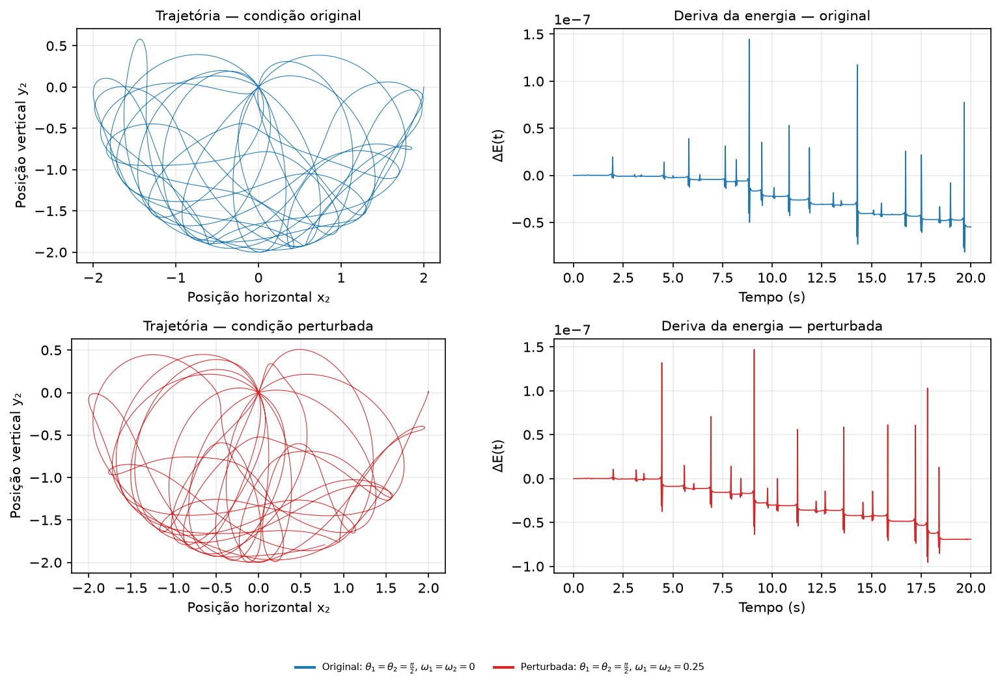

# Relatório do sistema do pêndulo duplo

## 1. Introdução e descrição física do sistema

O sistema investigado consiste em um pêndulo duplo planar, composto por duas hastes rígidas conectadas em sequência, sujeitas à ação da gravidade. Trata-se de um sistema mecânico clássico de dinâmica não linear, em que o movimento de uma haste influencia diretamente a outra por meio do acoplamento entre os ângulos de rotação.

As grandezas dinâmicas fundamentais do problema são os ângulos de deflexão das hastes em relação à vertical:

- $\theta_1$: ângulo da haste 1;
- $\theta_2$: ângulo da haste 2.

As velocidades angulares associadas são:

- $\omega_1 = \dot{\theta}_1$
- $\omega_2 = \dot{\theta}_2$

Assim, o vetor de estado do sistema pode ser escrito como:

$$
\mathbf{y} = \begin{bmatrix}
\theta_1 \\
\theta_2 \\
\omega_1 \\
\omega_2
\end{bmatrix}
$$

No código, essa estrutura é representada por:

```python
y = np.array([theta1, theta2, w1, w2])
```

e cada componente é acessado por meio da decomposição:

```python
theta1, theta2, w1, w2 = y
```

Essa correspondência é central para a interpretação física do modelo computacional: cada variável matemática do sistema possui uma analogia direta em termos de coordenadas e velocidades angulares do problema físico.

---

## 2. Formulação matemática e abstração do sistema

A dinâmica do pêndulo duplo pode ser escrita como um sistema de equações diferenciais ordinárias de primeira ordem, em forma compacta:

$$
\frac{d}{dt}
\begin{bmatrix}
\theta_1 \\
\theta_2 \\
\omega_1 \\
\omega_2
\end{bmatrix}
=
\begin{bmatrix}
\omega_1 \\
\omega_2 \\
\alpha_1 \\
\alpha_2
\end{bmatrix}
$$

em que $\alpha_1$ e $\alpha_2$ representam as acelerações angulares das hastes.

Essa representação é equivalente à forma implementada no código:

```python
def derivadas(y, g=9.8, l=1.0):
    a1, a2 = aceleracoes(y, g=9.8, l=1.0)
    return np.array([y[2], y[3], a1, a2])
```

A equivalência entre as variáveis é a seguinte:

- `y[0] = theta1 = \theta_1`
- `y[1] = theta2 = \theta_2`
- `y[2] = w1 = \omega_1`
- `y[3] = w2 = \omega_2`
- a saída do vetor é `[\omega_1, \omega_2, \alpha_1, \alpha_2]`

Essa reformulação é essencial para a integração numérica, pois transforma um problema de segunda ordem em um sistema de primeira ordem, compatível com métodos como Runge-Kutta.

---

## 3. Acelerações angulares e acoplamento dinâmico

A dinâmica do sistema depende diretamente da diferença angular entre as duas hastes, definida por:

$$
\Delta = \theta_1 - \theta_2
$$

No código, essa quantidade é calculada como:

```python
delta = theta1 - theta2
```

A variável $\Delta$ é central para o acoplamento entre as duas partes do sistema. Quando a diferença angular muda, as forças gravitacionais e as inércias relativas passam a influenciar o movimento conjunto das hastes. Esse termo incorpora, portanto, a não-linearidade do sistema, já que a resposta de cada haste depende da configuração instantânea da outra.

A seguir, o código introduz a quantidade:

$$
D = 16 - 9\cos^2(\Delta)
$$

escrita em Python como:

```python
den = 16 - 9 * np.cos(delta) ** 2
```

Esse denominador aparece nas acelerações angulares e pode ser interpretado como um fator geométrico de acoplamento. Em termos físicos, ele reflete a dependência da dinâmica com a configuração angular relativa das hastes.

As acelerações angulares são então dadas por:

$$
\alpha_1 =
-\frac{3\left(2\omega_2^2\sin\Delta + 3\cos\Delta\,\omega_1^2\sin\Delta + 6\frac{g}{l}\sin\theta_1 - 3\cos\Delta\frac{g}{l}\sin\theta_2\right)}{D}
$$

$$
\alpha_2 =
\frac{3\left(8\omega_1^2\sin\Delta + 3\cos\Delta\,\omega_2^2\sin\Delta - 8\frac{g}{l}\sin\theta_2 + 9\cos\Delta\frac{g}{l}\sin\theta_1\right)}{D}
$$

No código, essas expressões aparecem como:

```python
a1 = -3*(2*w2**2*np.sin(delta) + 3*np.cos(delta)*w1**2*np.sin(delta) + 6*(g/l)*np.sin(theta1) - 3*np.cos(delta)*(g/l)*np.sin(theta2)) / den
a2 =  3*(8*w1**2*np.sin(delta) + 3*np.cos(delta)*w2**2*np.sin(delta) - 8*(g/l)*np.sin(theta2) + 9*np.cos(delta)*(g/l)*np.sin(theta1)) / den
```

A correspondência entre as variáveis matemáticas e as variáveis do código é:

- `theta1` $\leftrightarrow \theta_1$
- `theta2` $\leftrightarrow \theta_2$
- `w1` $\leftrightarrow \omega_1$
- `w2` $\leftrightarrow \omega_2$
- `delta` $\leftrightarrow \Delta = \theta_1 - \theta_2$
- `den` $\leftrightarrow D = 16 - 9\cos^2(\Delta)$
- `g` $\leftrightarrow g$
- `l` $\leftrightarrow l$
- `a1` $\leftrightarrow \alpha_1$
- `a2` $\leftrightarrow \alpha_2$

Essas relações demonstram diretamente como a modelagem física é traduzida para a linguagem computacional adotada pelo algoritmo.

---

## 4. Energia mecânica do sistema

A energia total do pêndulo duplo é composta pela energia cinética e pela energia potencial gravitacional. A forma adotada no modelo é:

### Energia cinética

$$
T = \frac{m l^2}{6}\left(4\omega_1^2 + \omega_2^2 + 3\omega_1\omega_2\cos(\theta_1-\theta_2)\right)
$$

### Energia potencial

$$
U = -\frac{1}{2}mg l\left(3\cos\theta_1 + \cos\theta_2\right)
$$

### Energia total

$$
E = T + U
$$

No código, essa expressão é implementada como:

```python
def energia(y, m=1.0, g=9.8, l=1.0):
    th1, th2, w1, w2 = y
    T = m*l**2/6 * (4*w1**2 + w2**2 + 3*w1*w2*np.cos(th1 - th2))
    U = -0.5*m*g*l * (3*np.cos(th1) + np.cos(th2))
    return T + U
```

A comparação entre a fórmula matemática e a implementação é direta:

- `th1` $\leftrightarrow \theta_1$
- `th2` $\leftrightarrow \theta_2$
- `w1` $\leftrightarrow \omega_1$
- `w2` $\leftrightarrow \omega_2$
- `m` $\leftrightarrow m$
- `g` $\leftrightarrow g$
- `l` $\leftrightarrow l$

A análise da energia é importante porque oferece uma validação qualitativa do modelo: para um sistema conservativo ideal, a energia total deve variar pouco ao longo do tempo, embora pequenas oscilações numéricas possam aparecer pela discretização do método de integração.

---

## 5. Método numérico: Runge-Kutta de quarta ordem

A simulação numérica do sistema é realizada por meio do método de Runge-Kutta de quarta ordem (RK4), que aproxima a solução de problemas de valor inicial da forma:

$$
\frac{d\mathbf{y}}{dt} = \mathbf{f}(t, \mathbf{y})
$$

A atualização do vetor de estado é dada por:

$$
\mathbf{y}_{n+1} = \mathbf{y}_n + \frac{h}{6}(k_1 + 2k_2 + 2k_3 + k_4)
$$

onde:

$$
k_1 = f(t_n, \mathbf{y}_n)
$$

$$
k_2 = f\left(t_n + \frac{h}{2}, \mathbf{y}_n + \frac{h}{2}k_1\right)
$$

$$
k_3 = f\left(t_n + \frac{h}{2}, \mathbf{y}_n + \frac{h}{2}k_2\right)
$$

$$
k_4 = f(t_n + h, \mathbf{y}_n + hk_3)
$$

Em Python, esse procedimento aparece em:

```python
def rk4(fun, tempos, y0):
    y = [y0]
    dt = tempos[1] - tempos[0]

    for t in tempos[:-1]:
        k1 = fun(t, y[-1])
        k2 = fun(t + dt/2, y[-1] + k1*dt/2)
        k3 = fun(t + dt/2, y[-1] + k2*dt/2)
        k4 = fun(t + dt, y[-1] + dt*k3)

        y.append(y[-1] + dt/6 * (k1 + 2*k2 + 2*k3 + k4))
```

O passo temporal é definido por:

$$
 h = t_{n+1} - t_n
$$

No código, esse valor é calculado como:

```python
dt = tempos[1] - tempos[0]
```

Esse método é especialmente adequado para sistemas dinâmicos não lineares, como o pêndulo duplo, pois oferece maior precisão e estabilidade em comparação com esquemas mais simples, como o método de Euler.

---

## 6. Dinâmica do movimento do pêndulo duplo

O movimento do pêndulo duplo resulta da ação simultânea da gravidade, da inércia das duas hastes e do vínculo que une suas extremidades. A primeira haste recebe diretamente o torque gravitacional associado ao seu peso e ao peso da haste inferior; a segunda haste, por sua vez, é afetada pela gravidade e pelas acelerações impostas pela articulação superior.

Cada haste possui movimento angular próprio, descrito pelos pares $(\theta_1,\omega_1)$ e $(\theta_2,\omega_2)$. Esses pares não evoluem independentemente: a velocidade e a posição de uma haste modificam a aceleração da outra. Essa relação é representada pelos termos que contêm $\omega_1^2$, $\omega_2^2$, $\sin(\theta_1-\theta_2)$ e $\cos(\theta_1-\theta_2)$ nas equações diferenciais.

Quando o sistema é deslocado da posição vertical de equilíbrio, surge um componente da força gravitacional tangente à trajetória circular de cada massa. Esse componente tende a fazer as hastes retornarem à posição vertical, mas a transferência de momento angular entre elas pode originar oscilações assimétricas. Se uma haste gira rapidamente, parte de sua velocidade é redistribuída para a outra por meio das forças de ligação, fazendo com que o movimento da extremidade inferior seja muito mais complexo do que o de um pêndulo simples.

A não linearidade aparece explicitamente nas funções trigonométricas e no acoplamento dos termos quadráticos das velocidades. Portanto, aproximações válidas apenas para pequenas oscilações não descrevem adequadamente trajetórias largas. Dependendo das condições iniciais, o sistema pode apresentar movimentos periódicos ou quase periódicos, bem como inversões rápidas e comportamento aparentemente irregular.

Matematicamente, a dinâmica é obtida pela integração do sistema de primeira ordem

$$
\dot{\theta}_1=\omega_1,\qquad
\dot{\theta}_2=\omega_2,
$$

$$
\dot{\omega}_1=\alpha_1,\qquad
\dot{\omega}_2=\alpha_2.
$$

As acelerações $\alpha_1$ e $\alpha_2$ dependem tanto da configuração instantânea quanto das velocidades angulares. Assim, o estado futuro não é determinado apenas pela posição dos ângulos: é necessário conhecer também as duas velocidades angulares.

No ideal, sem atrito ou dissipação, a energia mecânica se conserva. O termo potencial transforma-se em energia cinética durante a descida das hastes e a energia cinética retorna ao potencial durante a subida. Na prática da simulação, pequenas variações da energia são esperadas devido ao erro temporal do método RK4. Além disso, pequenas diferenças nas condições iniciais podem produzir trajetórias bem distintas ao longo do tempo, uma característica associada à sensibilidade a condições iniciais da dinâmica caótica.

---

## 6.1 Origem matemática da não linearidade e do caos

Define-se o vetor de estado

$$
\mathbf{y}=\begin{bmatrix}\theta_1 & \theta_2 & \omega_1 & \omega_2\end{bmatrix}^{T}
$$

e o campo vetorial do sistema como

$$
\dot{\mathbf{y}}=\mathbf{F}(\mathbf{y})=
\begin{bmatrix}
\omega_1\\
\omega_2\\
\alpha_1(\theta_1,\theta_2,\omega_1,\omega_2)\\
\alpha_2(\theta_1,\theta_2,\omega_1,\omega_2)
\end{bmatrix}.
$$

Como o sistema não possui dependência explícita do tempo, trata-se de um sistema autônomo. Suas equações não são lineares por quatro motivos principais:

1. a gravidade contém termos proporcionais a $\sin\theta_1$ e $\sin\theta_2$;
2. o acoplamento depende de $\cos(\theta_1-\theta_2)$;
3. aparecem produtos entre diferenças angulares e velocidades ao quadrado;
4. as acelerações são divididas pelo fator $D=16-9\cos^2(\theta_1-\theta_2)$.

Consequentemente, não é possível separar o sistema em duas equações independentes e construir uma solução linear formada por superposição de modos. Para oscilações pequenas, é possível aproximar

$$
\sin\theta_i\approx\theta_i,
\qquad
\cos(\theta_1-\theta_2)\approx 1,
$$

mas essa aproximação deixa de representar o movimento conforme os ângulos e as velocidades aumentam.

A matriz que localmente descreve a variação infinitesimal do estado é o jacobiano

$$
J(\mathbf{y})=
\frac{\partial \mathbf{F}}{\partial \mathbf{y}}.
$$

Dada uma trajetória de referência $\mathbf{y}(t)$ e uma perturbação infinitesimal $\delta\mathbf{y}(t)$, a dinâmica da perturbação é aproximada por

$$
\frac{d}{dt}(\delta\mathbf{y})
\approx J(\mathbf{y}(t))\,\delta\mathbf{y}.
$$

Como $J$ depende da posição e da velocidade instantâneas, a separação entre duas soluções não permanece constante. Em regiões favoráveis à instabilidade, uma perturbação pode crescer aproximadamente segundo

$$
\|\delta\mathbf{y}(t)\|
\approx
\|\delta\mathbf{y}(0)\|e^{\lambda t},
$$

em que $\lambda$ é um expoente característico positivo médio ou um expoente de Lyapunov. Esse crescimento não significa que o movimento seja aleatório: ele continua determinado pelas equações. Significa apenas que previsões a tempos longos exigem uma precisão cada vez maior na condição inicial.

Os termos de velocidade ao quadrado atuam como forças inerciais dependentes da própria dinâmica. Já os termos de gravidade alteram o potencial em função dos ângulos. O denominador $D$ também depende da diferença angular e pode se tornar fator de acoplamento mais intenso. Quando uma haste passa por uma configuração crítica, sua aceleração pode redistribuir rapidamente energia para a outra haste, mudando o sentido do movimento e produzindo trajetórias aparentemente irregulares.

Apesar da aparente complexidade, o sistema ideal não possui atrito. Para cada estado, a energia total é

$$
E=T+U,
$$

com

$$
T=\frac{ml^2}{6}\left(4\omega_1^2+\omega_2^2+3\omega_1\omega_2\cos(\theta_1-\theta_2)\right)
$$

e

$$
U=-\frac12 mgl\left(3\cos\theta_1+\cos\theta_2\right).
$$

Como o sistema é conservativo, espera-se

$$
\frac{dE}{dt}=0.
$$

Portanto, a trajetória não ocupa arbitrariamente todo o espaço de estados: ela permanece sobre uma superfície determinada pela energia inicial. Com quatro variáveis de estado e uma conservação de energia, resta uma variedade tridimensional efetiva para a evolução. Mesmo assim, essa restrição não impede movimento caótico, pois o fluxo pode permanecer limitado a uma região irregular e não periódica.

Para avaliar a sensibilidade, considera-se duas condições iniciais próximas:

$$
\mathbf{y}_{1}(0)=\mathbf{y}_{0}(0),
\qquad
\mathbf{y}_{2}(0)=\mathbf{y}_{0}(0)+\delta\mathbf{y}_0.
$$

A distância relevante é

$$
\varepsilon(t)=\left\|\mathbf{y}_2(t)-\mathbf{y}_1(t)\right\|.
$$

No movimento observado nesta simulação, o estado perturbado utiliza

$$
\omega_1(0)=0{,}25,
\qquad
\omega_2(0)=0{,}25.
$$

Essa mudança introduz energia cinética adicional e altera a dinâmica ao longo de todo o intervalo. Mesmo com variação inicial limitada, o acoplamento não linear pode ampliar separações de estados ao longo do tempo.

Assim, o caos no pêndulo duplo não é explicado por forças aleatórias ou por falta de precisão do método RK4. Ele resulta de um sistema determinístico, não linear, acoplado e sensível às condições iniciais. O método numérico aproxima cada trajetória; em intervalos longos, diferenças muito pequenas na condição inicial ou no erro acumulado podem direcionar a solução por configurações completamente distintas.

---

## 7. Condição inicial e interpretação do movimento

A simulação parte da condição inicial:

```python
y0 = np.array([np.pi/2, np.pi/2, 0.0, 0.0])
```

ou seja,

$$
\theta_1(0)=\frac{\pi}{2}, \quad \theta_2(0)=\frac{\pi}{2}, \quad \omega_1(0)=0, \quad \omega_2(0)=0
$$

Esse estado corresponde a duas hastes inicialmente posicionadas horizontalmente e em repouso. Sob a ação da gravidade, o sistema é impulsionado para a evolução dinâmica, e o conjunto das variáveis $\theta_1(t)$ e $\theta_2(t)$ descreve a configuração temporal do mecanismo.

Como o sistema é não linear e acoplado, pequenas variações nas condições iniciais podem levar a trajetórias significativamente diferentes, característica frequentemente associada à dinâmica caótica.

---

## 8. Trajetória da extremidade da haste 2

Para visualizar o movimento em coordenadas cartesianas, o código converte os ângulos em posições planas por meio das relações:

$$
x_2 = l\sin\theta_1 + l\sin\theta_2
$$

$$
y_2 = -l\cos\theta_1 - l\cos\theta_2
$$

No programa, essa conversão é implementada por:

```python
x2 = l*np.sin(Y[:, 0]) + l*np.sin(Y[:, 1])
y2 = -l*np.cos(Y[:, 0]) - l*np.cos(Y[:, 1])
```

Essa etapa é importante porque permite transformar um problema angular em uma descrição geométrica. O par $(x_2, y_2)$ representa a posição da extremidade da segunda haste ao longo do tempo, e o gráfico correspondente fornece uma visualização direta da trajetória executada pelo sistema.

A construção da trajetória em plano é relevante tanto para a análise qualitativa quanto para a validação do modelo: a forma da curva observada reflete a evolução conjunta dos ângulos, e consequentemente a dinâmica do acoplamento entre as hastes.

---

## 9. Análise da energia ao longo da simulação

O código calcula a evolução da energia mecânica do sistema em função do tempo:

```python
Es = np.array([energia(y) for y in Y])
print("deriva máxima da energia:", np.max(np.abs(Es - Es[0])))
```

A quantidade observada é:

$$
\Delta E(t) = E(t) - E(0)
$$

e o gráfico correspondente permite avaliar a variação da energia em relação ao valor inicial. Em um modelo ideal conservativo, espera-se que essa diferença permaneça pequena, embora não nula, devido à aproximação numérica. A análise da energia, portanto, funciona como um indicador de consistência do esquema de integração e da formulação do modelo.

---

## 10. Interpretação abstrata do sistema dinâmico

Do ponto de vista da teoria dos sistemas dinâmicos, o pêndulo duplo pode ser representado como um sistema de dimensão quatro, pois o estado é dado por:

$$
\mathbf{y} = (\theta_1, \theta_2, \omega_1, \omega_2)
$$

Portanto, o espaço de estados é quatro-dimensional e o comportamento do sistema depende fortemente da evolução temporal de cada variável. A dinâmica é não linear e o acoplamento entre as hastes produz uma resposta complexa, em que pequenas alterações nas condições iniciais podem gerar trajetórias muito diferentes.

Essa propriedade é típica de sistemas dinâmicos não lineares e é uma das razões pelas quais o pêndulo duplo aparece frequentemente em estudos de caos, estabilidade e modelagem mecânica.

---

## 11. Conclusão

O modelo matemático e a implementação computacional do pêndulo duplo são coerentes entre si: as variáveis do código correspondem diretamente às grandezas físicas do sistema, e as equações diferenciais são discretizadas numericamente por meio do método RK4. As principais variáveis envolvidas são:

- $\theta_1$, $\theta_2$: ângulos das hastes;
- $\omega_1$, $\omega_2$: velocidades angulares;
- $g$: aceleração gravitacional;
- $l$: comprimento das hastes;
- $m$: massa;
- $\Delta = \theta_1 - \theta_2$: diferença angular de acoplamento.

Assim, o programa não apenas simula o movimento, mas traduz, em linguagem computacional, a estrutura física e matemática do sistema. A integração numérica, a energia e a trajetória geométrica constituem ferramentas complementares para compreender a dinâmica do pêndulo duplo e avaliar a validade da representação adotada.

Em síntese, o notebook implementa uma discretização numérica do modelo físico do pêndulo duplo, permitindo a análise do comportamento do sistema em termos de movimento, energia e geometria da trajetória.

---

## 12. Comparação das condições iniciais e comportamento caótico

Foram comparadas duas condições iniciais do pêndulo duplo. Na condição original, ambas as hastes começam na horizontal e em repouso:

$$
\theta_1(0)=\frac{\pi}{2}, \quad \theta_2(0)=\frac{\pi}{2}, \quad \omega_1(0)=0, \quad \omega_2(0)=0.
$$

Na condição perturbada, as posições angulares são mantidas, mas são atribuídas velocidades angulares iniciais às duas hastes:

$$
\theta_1(0)=\frac{\pi}{2}, \quad \theta_2(0)=\frac{\pi}{2}, \quad \omega_1(0)=0{,}25, \quad \omega_2(0)=0{,}25.
$$

### 12.1 Variáveis utilizadas nas condições comparadas

No notebook, as duas condições são representadas pelos vetores

$$
\mathbf{y}_0=
\begin{bmatrix}
\theta_1(0)\\
\theta_2(0)\\
\omega_1(0)\\
\omega_2(0)
\end{bmatrix}
=
\begin{bmatrix}
\pi/2\\
\pi/2\\
0\\
0
\end{bmatrix}
$$

e

$$
\mathbf{y}_1=
\begin{bmatrix}
\theta_1(0)\\
\theta_2(0)\\
\omega_1(0)\\
\omega_2(0)
\end{bmatrix}
=
\begin{bmatrix}
\pi/2\\
\pi/2\\
0{,}25\\
0{,}25
\end{bmatrix},
$$

correspondentes às condições original e perturbada.

As implementações utilizadas no notebook são:

```python
y0 = np.array([np.pi/2, np.pi/2, 0.0, 0.0])
Y = rk4(fun, tempos, y0)

y1 = np.array([np.pi/2, np.pi/2, 0.25, 0.25])
Y1 = rk4(fun, tempos, y1)
```

Assim, `Y` contém a evolução da condição original e `Y1` contém a evolução da condição perturbada. As energias associadas são armazenadas em `Es` e `Es1`:

```python
Es = np.array([energia(y) for y in Y])
Es1 = np.array([energia(y) for y in Y1])
```

As coordenadas da extremidade da segunda haste são:

```python
x2 = l*np.sin(Y[:, 0]) + l*np.sin(Y[:, 1])
y2 = -l*np.cos(Y[:, 0]) - l*np.cos(Y[:, 1])

x = l*np.sin(Y1[:, 0]) + l*np.sin(Y1[:, 1])
y = -l*np.cos(Y1[:, 0]) - l*np.cos(Y1[:, 1])
```

Portanto, $(x_2,y_2)$ representa a trajetória da condição original, enquanto $(x,y)$ representa a trajetória da condição perturbada.



Os gráficos superiores correspondem à condição original e os inferiores, à condição perturbada. As curvas azuis representam o caso sem velocidades iniciais, enquanto as curvas vermelhas representam o caso perturbado.

### 12.2 Comportamento caótico

A adição de $\omega_1(0)=0{,}25$ e $\omega_2(0)=0{,}25$ fornece energia cinética ao sistema e modifica o modo como as hastes trocam energia potencial e cinética. Essa sensibilidade é uma manifestação central da dinâmica caótica: como o sistema é não linear e possui acoplamento entre $\theta_1$ e $\theta_2$, diferenças no estado inicial podem crescer ao longo do tempo.

Os gráficos da direita apresentam

$$
\Delta E(t)=E(t)-E(0).
$$

Pequenas oscilações próximas de zero mostram que o método RK4 conserva razoavelmente a energia. Assim, as diferenças observadas nas trajetórias estão associadas principalmente às condições iniciais e à não linearidade do modelo, e não à perda artificial de energia.

A condição perturbada não possui necessariamente um movimento periódico previsível. O acoplamento entre hastes e os termos trigonométricos das equações produzem forças que alteram continuamente a direção e a velocidade das massas. Esse processo gera trajetórias irregulares, curvas fechadas incompletas e mudanças súbitas no sentido de giro.

O comportamento observado é característico de caos determinístico: a evolução é completamente definida pelas equações e pela condição inicial, mas a previsão prática torna-se difícil para tempos longos. Uma pequena variação em qualquer componente de $\mathbf{y}$ pode ser amplificada pela dinâmica não linear, produzindo trajetórias progressivamente distintas.
